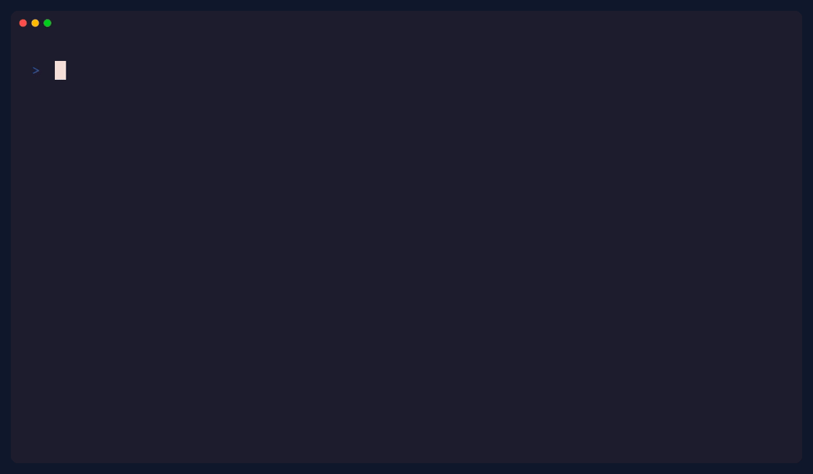

# ForgeFix



**One command to set up, health-check, and repair any open-source project.**

`forgefix doctor` tells a newcomer exactly what a repository is missing — README, install
line, lockfile, CI, security policy, license, working dev environment — with a deterministic
0–100 health score and concrete fixes. `forgefix up` then does the bring-up: it detects the
stack, repairs missing setup files, installs dependencies, and runs the tests.

- **Original code, MIT licensed.** ForgeFix reads repository *metadata* only (file names,
  README text, config keys). It never copies source code from the projects it inspects.
- **No shells, no eval.** Every external command runs as a sanitized argument list with a
  bounded timeout. `bandit` and `gitleaks` are wired into CI and pre-commit.

## Quickstart (30 seconds)

```bash
pip install forgefix        # once published; or: pip install -e .
cd your-project
forgefix doctor             # see the score + what to fix
forgefix up                 # dry-run: shows the bring-up plan
forgefix up --apply         # repairs + venv + deps + tests (never overwrites files)
forgefix report             # writes reports/forgefix-report.md
```

Try it on the bundled fixtures right now:

```bash
forgefix doctor --path tests/fixtures/broken_repo    # -> 42/100
forgefix doctor --path tests/fixtures/minimal_repo   # -> 100/100
```

## Why

Every contributor's first hour in a new repository is the same loop: clone, guess the
install command, discover there is no lockfile, hunt for the test runner, wonder whether
the project is even maintained. Maintainers keep re-explaining the same missing pieces in
issues. ForgeFix turns that tribal knowledge into one deterministic, scriptable check that
both humans and CI can run.

## Features

| Command | What it does |
| --- | --- |
| `forgefix doctor` | Health table (pass / warn / fail / skip) with fix suggestions; `--json` for machines, `--min-score` for gates |
| `forgefix up` | Dry-run-by-default bring-up: stack detection, create-if-missing setup repairs, venv + deps, tests, optional dev server (`--apply` to execute) |
| `forgefix report` | Markdown report with score, category breakdown, and top fixes |
| `forgefix serve` | FastAPI server exposing the same checks at `/health`, `/doctor`, `/report` |
| `forgefix init` | Scaffolds a `.forgefix.yml` (disable rules, set a score gate) |
| Plugins | Third-party checks via the `forgefix.plugins` entry-point group |

The health score is deterministic and unit-tested: every rule carries fixed fail/warn
weights, so the same repository always scores the same.

## How it compares (by category, not by name)

ForgeFix does not replace linters, formatters, or container starters — it complements
them, one layer higher:

| Category | What it covers | What ForgeFix adds |
| --- | --- | --- |
| Linters / formatters (ruff, eslint class) | Code style and correctness inside files | Repository-level *onboarding* health that no in-file linter sees |
| Container starters (cookiecutter / devcontainer class) | Bootstrapping a new project | Works on the **existing** repos you already cloned |
| Manual README checklists | What maintainers *should* document | A score, a CI gate, and a JSON API so "should" becomes "does" |

## Safety model

- **Read-only scans.** `doctor` and `report` open files and read text. They never execute
  repository code and never touch the network.
- **`up` is dry-run by default.** With `--apply` it only *creates missing* files
  (README skeleton, SECURITY.md, .editorconfig, CI workflow) and never overwrites an
  existing file. It deliberately never invents a LICENSE for you.
- **No shell interpolation.** Commands are fixed argument lists with full executable
  paths, `shell=False`, and bounded timeouts.

## Plugins

```python
# my_forgefix_plugin.py
from pathlib import Path
from forgefix.core.rules import Finding


class MyPlugin:
    name = "my-plugin"

    def check(self, root: Path) -> list[Finding]: ...
```

Register it under the `forgefix.plugins` entry-point group; ForgeFix discovers it
automatically. A broken plugin is logged and skipped — it can never break a scan.
See [docs/plugins.md](docs/plugins.md).

## Roadmap

- [x] Deterministic doctor/report/serve + bring-up
- [x] Plugin API (`forgefix.plugins`)
- [ ] Richer stack detection (rust, java/gradle) and per-rule fix scripts
- [ ] SARIF export for GitHub code scanning
- [ ] `forgefix cloud` hosted dashboard for private repos — see [docs/monetization.md](docs/monetization.md)

## Development

```bash
make setup     # editable install + pre-commit hooks
make test      # pytest (coverage gate 85%)
make lint      # ruff check + format check
make type      # mypy
make gif       # regenerate demo/demo.gif with vhs
```

Full guidelines in [CONTRIBUTING.md](CONTRIBUTING.md). Docs site: `mkdocs serve`
(config in [mkdocs.yml](mkdocs.yml), pages in [docs/](docs/)).

## Security

Report vulnerabilities privately per [SECURITY.md](SECURITY.md) — 48h acknowledgement SLA.

## License

[MIT](LICENSE) © ForgeFix contributors. Original code; no source copied from other
projects.
